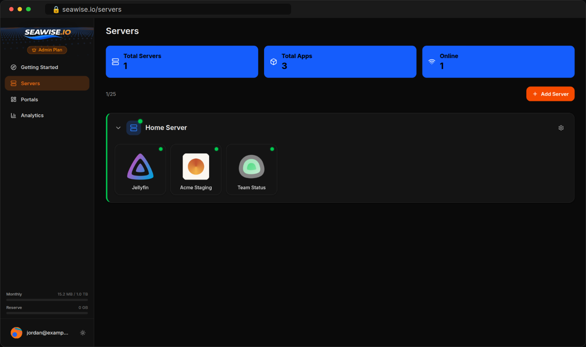

<p align="center">
  <a href="https://seawise.io">
    
  </a>
</p>
<p align="center">
  <a href="https://github.com/seawise-io/seawise-client/releases/latest"></a>
  <a href="https://github.com/seawise-io/seawise-client/actions/workflows/ci.yml"></a>
  <a href="https://github.com/seawise-io/seawise-client/blob/main/LICENSE"></a>
  <a href="https://ghcr.io/seawise-io/seawise-client"></a>
</p>

# Seawise.io Client

Share your self-hosted apps with family, friends or clients. Jellyfin, Plex, Seerr, Immich, Home Assistant or anything else with a web page.

Run one Docker container, connect it to your [Seawise.io](https://seawise.io) account, and pick which apps to make reachable. Visitors sign in with Google, GitHub or an email link and only see the apps you share with them. Nothing for them to install.

Works behind CGNAT, double NAT and firewalls. No port forwarding, no VPN, no domain or DNS setup.

<p align="center">
  
</p>

## Quick Start

Linux:

```bash
docker run -d --name seawise \
  --restart unless-stopped \
  --network host \
  -e SEAWISE_HOST_NETWORK=true \
  -v seawise-data:/config \
  ghcr.io/seawise-io/seawise-client:latest
```

Docker Desktop (macOS, Windows):

```bash
docker run -d --name seawise \
  --restart unless-stopped \
  -p 8082:8082 \
  -v seawise-data:/config \
  ghcr.io/seawise-io/seawise-client:latest
```

Docker Compose: use the [`docker-compose.yml`](docker-compose.yml) in this repo.

Then open [http://localhost:8082](http://localhost:8082), or `http://your-server-ip:8082` from another computer on your network.

## Setup

1. Set a password for the web UI right away. This has to happen within 5 minutes of the container starting. If the window passes, run `docker restart seawise` to open it again.
2. Click **Connect to Seawise.io** and approve the connection in your browser.
3. Add apps by name, host and port.

Each app gets its own address on `seawise.dev`. Apps are private: only you can open them after signing in, until you add them to a portal and invite people.

## What People Use It For

| App | Guide |
|-----|-------|
| Jellyfin | [Share Jellyfin with family](https://seawise.io/guides/share-jellyfin-with-family) |
| Seerr (Jellyseerr, Overseerr) | [Let friends request movies](https://seawise.io/guides/seerr-requests-from-anywhere) |
| Sonarr, Radarr, Prowlarr | [Your *arr stack from anywhere](https://seawise.io/guides/share-arr-stack) |
| Plex | [Plex in the browser](https://seawise.io/guides/share-plex-in-browser) |
| Immich | [Share Immich with family](https://seawise.io/guides/share-immich-with-family) |
| Home Assistant | [Home Assistant from anywhere](https://seawise.io/guides/home-assistant-remote-access) |
| Open WebUI, ComfyUI | [Share your local AI](https://seawise.io/guides/open-webui-share-with-friends) |

More in the [guides](https://seawise.io/guides), including CGNAT, sharing with clients and per-person access.

## Adding Apps

| Your app runs... | Host to use |
|------------------|-------------|
| On the same machine, client started with `--network host` | `localhost` |
| In the same Docker Compose file | The service name, e.g. `grafana` |
| On the same machine, client on Docker Desktop | `host.docker.internal` |
| On another device on your network | Its IP, e.g. `192.168.1.50` |

Link-local addresses (`169.254.0.0/16`, `fe80::/10`), including cloud metadata endpoints, can't be added.

## FAQ

**Do I need port forwarding, a public IP or a domain?**
No. The client connects out to Seawise.io, so nothing on your router changes. It works behind CGNAT.

**Is it safe to share Jellyfin or Immich this way?**
Apps are private by default. Visitors sign in before they reach anything, and you choose who can open each app. Nothing on your network is opened to the internet.

**Do the people I share with need an account or an app?**
They sign in with Google, GitHub or an email link in any browser. Nothing to install.

**How is this different from Cloudflare Tunnel, Tailscale or ngrok?**
See [the comparison](https://seawise.io/compare). In short: no domain needed, sign-in for guests is built in, and you get portals, one page per group of people with the apps you share.

**What does it cost?**
The free plan covers one server, 30 apps and one portal. See [pricing](https://seawise.io/pricing).

## Docker Compose

```yaml
services:
  seawise:
    image: ghcr.io/seawise-io/seawise-client:latest
    container_name: seawise
    restart: unless-stopped
    network_mode: host
    environment:
      SEAWISE_HOST_NETWORK: "true"
    volumes:
      - seawise-data:/config

volumes:
  seawise-data:
```

On Docker Desktop, replace `network_mode` and `environment` with `ports: ["8082:8082"]`.

## Security

- **Outbound only.** The client opens the connection to Seawise.io. Nothing on your network is opened to the internet.
- **This client decides what is reachable.** Apps are added and changed only here. The Seawise.io website and servers can't add apps or change where they point.
- **Verified tunnel.** The client only connects to `*.seawise.dev` and checks the server's TLS certificate.
- **Protected web UI.** Password required, stored as a bcrypt hash, with a growing delay after failed attempts. The first-run password window closes after 5 minutes.

To report a vulnerability, see [SECURITY.md](SECURITY.md).

## What the Client Sends

To Seawise.io:

- The server name you choose when connecting.
- Each app's name, host and port, when you add it.
- Every 30 seconds: whether the tunnel is connected, how many apps there are and the client version.
- Whether each app is up or down.

To the tunnel server: the tunnel login, which includes the FRP version, operating system, CPU type and the machine's hostname, and then the traffic for the apps you've shared.

To GitHub: a check for new releases, which powers the update banner.

It never sends your apps' content or files, its logs, the web UI password, or anything about apps you haven't added. It doesn't scan your network.

## Environment Variables

| Variable | Default | Description |
|----------|---------|-------------|
| `SEAWISE_PORT` | `8082` | Web UI port |
| `SEAWISE_BIND_ADDR` | `0.0.0.0` | Bind address. Set to `127.0.0.1` to only allow the UI from the same machine. |
| `SEAWISE_DATA_DIR` | `/config` | Persistent data directory |
| `SEAWISE_HOST_NETWORK` | `false` | Set to `true` when running with `--network host`. |
| `SEAWISE_TLS` | _(unset)_ | Set to `auto` to serve the web UI over HTTPS with a self-signed certificate. |
| `SEAWISE_TRUST_PROXY` | `false` | Set to `true` behind a reverse proxy so login rate limiting uses `X-Forwarded-For`. |
| `SEAWISE_ALLOWED_HOSTS` | _(unset)_ | Comma-separated DNS names allowed to reach the web UI, e.g. `client.mycompany.com` behind an ingress. Not needed for localhost, LAN IPs or `*.local`. |
| `SEAWISE_LOG_LEVEL` | `info` | `debug`, `info`, `warn` or `error` |
| `PUID` / `PGID` | `1000` | User and group ID to run as |

## Health Checks

| Endpoint | Returns | Use for |
|----------|---------|---------|
| `GET /healthz` | 200 while the web server responds | Liveness. The image's built-in Docker `HEALTHCHECK` uses it. |
| `GET /readyz` | 200 when paired and the tunnel is running, otherwise 503 | Readiness. The body includes `paired`, `frp_running` and `version`. |

Both are unauthenticated.

## Updating

```bash
docker pull ghcr.io/seawise-io/seawise-client:latest
docker stop seawise && docker rm seawise
# Run the same docker run command again. Pairing, apps and password are kept in the volume.
```

With Compose: `docker compose pull && docker compose up -d`.

The web UI shows a banner when a new version is available.

## Platform Support

- **Images:** Linux amd64 and arm64 (Raspberry Pi, most NAS devices)
- **Hosts:** Linux, macOS and Windows with Docker, Unraid, Synology, TrueNAS
- **Requirements:** Docker 20+, outbound HTTPS (port 443)

## Documentation

- [Quick start](https://docs.seawise.io/getting-started/quick-start)
- [Apps](https://docs.seawise.io/apps)
- [Portals and sharing](https://docs.seawise.io/dashboards)
- [Client configuration](https://docs.seawise.io/client/configuration)
- [Security](https://docs.seawise.io/security)
- [Guides](https://seawise.io/guides)

## License

MIT. Tunnels use [FRP](https://github.com/fatedier/frp) (Apache 2.0); its license ships in the image at `/app/licenses/frp-LICENSE`.
